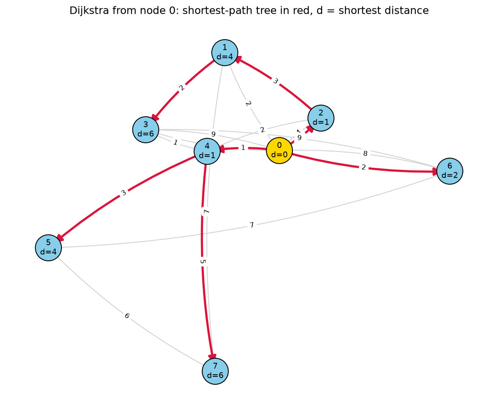

# Pathfinding Algorithms from Scratch

Shortest-path algorithms implemented from scratch in Python, tested with pytest, and checked against NetworkX.

## Dijkstra



The figure shows a random weighted directed graph. Each node's shortest distance `d` from node 0 comes from my implementation (`pathfinder/dijkstra.py`), and the red edges form the shortest-path tree. `visualize.py` also checks every distance against NetworkX's built-in Dijkstra.

## How to run

```bash
pip install -r requirements.txt
pytest                  # run the tests
python visualize.py     # check against NetworkX and regenerate the figure
```